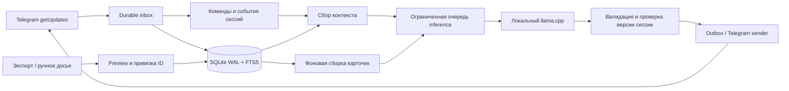

# Архитектура и поведение

## 1. Цель и границы первой версии

Нужна уместная короткая реплика, привязанная к конкретному разговору и манере участника. Не генератор случайных оскорблений. Бот различает: «он сам сказал», «про него пошутили», «оператор добавил заметку». Чужая шутка не превращается в биографический факт.

V1 включает: группы/supergroups, текст и подписи, накопление новых сообщений, импорт JSON Telegram Desktop и ручного досье, привязку к числовому user_id, выборочный контекст, короткие дуэли, удаление данных, работу без облачной LLM. Обработка голосовых, OCR, картинки, web-поиск о человеке, userbot, fine-tuning, векторная БД и web UI не нужны.

Предполагаем личное развёртывание, несколько небольших групп, одну GPU с 16 ГБ VRAM. Производитель GPU неизвестен: CUDA — основной вариант для NVIDIA; Vulkan — отдельный проверяемый вариант, а не обещание той же скорости.

## 2. Пользовательский сценарий

1. Администратор добавляет бота, включает чтение группы и `/enable_chat`. Бот публикует описание хранения, импорта, участия и остановки. Пока группа не включена — сообщения не архивировать.
2. Участник выполняет `/roast_on`. Это разрешение на прожарку в этой группе, а не во всех чатах. `/roast_off` запрещает новые вызовы, закрывает текущие, отменяет ещё не отправленные результаты.
3. Владелец заранее импортирует выбранную историю; числовой ID определяется через `/whois` в reply на сообщение участника. Импорт не включает участие автоматически.
4. Вызов: `/roast @maxwell17 600 дней в Reddit` либо reply на его сообщение с `/roast`, либо `@pozor_me_bot попусти @maxwell17 ...`. Парсер понимает эти три формы; произвольный natural-language router не нужен.
5. Проверяются разрешения, target, cooldown и доступность очереди. Бот собирает последние реплики, цитаты target, реплики о нём и материалы импорта; генерирует один ответ в 1–2 предложения.
6. Если target отвечает **на сообщение бота текущей сессии** либо явно упоминает бота в той же теме, продолжаем. Обычный разговор target с другими не вызывает ответы.
7. `/stop`, кнопка «Стоп», «стоп/хватит/отстань/не продолжай» от target при обращении к боту закрывают сессию немедленно. `/finish` от инициатора, target или администратора тоже завершает. Разговорное «всё, доминация» от инициатора обрабатывается только как отдельная команда-фраза в reply на сессию, не как LLM-оценка победителя.

Мат возможен по настройке группы; остроумие строится на поступке, привычке, противоречии и цитате. Не использовать адреса, контакты, здоровье, сексуальную жизнь, защищённые характеристики, угрозы или выдуманные серьёзные обвинения. Не давать модели права менять настройки/согласие/таймеры. Техническая проверка не гарантирует качество юмора: нужен небольшой ручной набор оценок.

## 3. Ограничения Telegram

- Стандартный Bot API не предоставляет выгрузку прежней истории группы. Получаем новые updates; старую историю приносит оператор экспортом. Не строить несуществующий `getChatHistory`.
- Для чтения обычного контекста отключить privacy mode через BotFather, проверить эффект в тестовой группе; если требуется, повторно добавить бота. Админские права ради чтения не требуются. [Bot features](https://core.telegram.org/bots/features#privacy-mode).
- Username бота не содержит точку и при обычной регистрации заканчивается на `bot`; `pozor.me` остаётся названием. [BotFather](https://core.telegram.org/bots/features#botfather).
- Не полагаться на сообщения других ботов; всегда исключать `from.is_bot`, в том числе при изменении возможностей платформы.
- Update — не журнал навсегда: Telegram хранит недоставленные updates не дольше 24 часов. Offset подтверждать после сохранения. Entity offsets заданы в UTF-16. [Bot API](https://core.telegram.org/bots/api).
- Нет надёжного универсального поиска user_id произвольного человека по `@username`. Источник идентичности — `from.id`, `text_mention.user.id`, reply и локальный каталог наблюдавшихся пользователей. Имя «Макс» не идентификатор.
- Статус online/AFK не нужен: истечение таймера означает только отсутствие подходящих ответов боту.
- Обычные удаления сообщений группы могут не прийти update-ом. Не обещать зеркалирование удаления; собственные purge/TTL обязательны.

## 4. Процессы и поток данных

Один asyncio-процесс: polling, короткие DB-транзакции, обработчик событий, sender, планировщик/cleanup. Один отдельный llama-server с одной загруженной моделью. Ни Redis, ни Celery, ни микросервисов в V1. SQLite — локальный диск, не сетевой share.

## 5. Модули будущего приложения

| Модуль | Ответственность | Не должен делать |
|---|---|---|
| `config.py` | Pydantic settings, проверка диапазонов, разрешённые chat IDs | Читать секреты в лог |
| `telegram/receiver.py` | getUpdates, durable inbox, checkpoint | Генерировать ответы |
| `telegram/parser.py` | Entities, команды, reply, target resolution | Угадывать ID по имени |
| `telegram/sender.py` | Outbox, rate limit, retry_after, форматирование | Самостоятельно возобновлять дуэль |
| `storage/` | SQL-миграции, транзакции, FTS, репозитории | Сетевые запросы внутри транзакции |
| `imports/` | Адаптеры, preview, manifest, применение/откат | Запускать сессии по импортированным командам |
| `context/` | Индексы, ранжирование, бюджет, provenance | Брать данные чужого чата |
| `profiles/` | Карточки тем и цитат, watermarks, инвалидирование | Строить психодиагнозы |
| `sessions/` | Детерминированные состояния, лимиты, отмена | Доверять LLM в вопросе остановки |
| `llm/` | HTTP adapter, очередь, timeout, structured output | Выполнять tools из ответа модели |
| `prompts/` | Версионированные шаблоны и JSON schemas | Интерполировать сообщения в system role |
| `cli.py` | run/migrate/doctor/import/forget/benchmark | Требовать реальный Telegram для тестов |

## 6. Надёжность обработки

Polling реализовать через aiogram Bot API client, но с собственным небольшим циклом durable inbox: запросить batch → транзакционно сохранить нормализованные события и `next_offset=max(update_id)+1` → commit → следующий запрос. Сетевое подтверждение приходит следующим getUpdates. Дубликаты отсекает PK `update_id`. Не хранить бесконечно raw updates с текстом — нормализовать и чистить payload.

Стандартное параллельное dispatching aiogram не считать гарантией записи перед offset. На старте `getWebhookInfo`: если webhook есть, завершить с инструкцией, не удалять молча. Один poller на bot token. [Aiogram polling](https://docs.aiogram.dev/en/latest/dispatcher/long_polling.html).

После ingestion отдельный worker делает inbox → message/index/session job одной транзакцией. ACK пользовательского ответа не ждёт LLM. DB lock никогда не удерживается во время inference. При заполнении inference-очереди ingestion продолжается.

Outbox: уникальность `(session_id, turn_no)`. Перед отправкой проверить сессию, revision, TTL, согласие и evidence epoch. Перед HTTP пометить `sending`, после успеха сохранить Telegram message_id и `sent`. При crash/сетевом timeout после возможной доставки — `unknown`, автоматически не повторять: Bot API sendMessage не даёт универсального idempotency key. Возможен потерянный ответ; не обещать exactly-once. Явный 429 — отложить на retry_after и снова проверить актуальность; 403 — отключить чат/отменить сессию. Восстановление `sending` после рестарта → `unknown`.

## 7. Сессия

Ключ области: `(chat_id, thread_id)`, где нет темы → `0`. В V1 одна активная дуэль на область. В других темах могут быть другие, но глобальная GPU-очередь ограничена. Состояния: `active → closed`; генерация/отправка — отдельные состояния turn, не отдельная бессмертная сессия.

Начальные настройки: 4 ответа бота включая первый; 5 минут максимальная длительность; 90 секунд ожидания после отправки; 10 секунд минимум между ответами; 10 минут cooldown на target в группе; 30 секунд cooldown инициатора. Это продуктовые defaults, не платформенные лимиты. Timeout во время генерации ограничен deadline запроса. Молчание закрывает без финального выпада.

Быстрые сообщения target объединять за 1.2 секунды, максимум ожидания 3 секунды; один pending turn. Сохранять ID всех включённых сообщений. Новая реплика до начала inference обновляет turn; во время inference повышает revision и заменяет устаревший job после завершения, не запускает второй параллельно. При непрерывном потоке максимум 2 пересборки, затем ждать следующего прямого обращения — не зависнуть в regenerate loop.

`/stop` должен обрабатываться даже при занятой GPU. Локальный lock на область + проверка revision в транзакции перед outbox; sender проверяет ещё раз. Если HTTP уже ушёл, отмена не может гарантированно отозвать сообщение: документировать этот узкий race, но после обработанного stop не начинать новые отправки.

## 8. Контракты

Все время в UTC timezone-aware; пользовательские даты отображаются в настроенной зоне. ID Telegram — int64, message_id уникален только внутри source chat. Decimal ID хранить без потери точности.

`NormalizedMessage`: scope_chat_id, thread_id, source_namespace, source_message_id, author_user_id|null, text, occurred_at, edited_at|null, reply_source_id|null, mentions[], origin(live/export/manual), batch_id|null, relation(self/mention/reply/context/manual), text_hash.

`RoastRequest`: request_id, trigger_message_id, chat_id, thread_id, initiator_id, target_id, hint, requested_at. Hint — утверждение инициатора, не подтверждение факта.

`Evidence`: evidence_id, source keys, author, relation, text, timestamp, attribution(observed_self/third_party/manual_claim), allowed_target_id, policy_version. `ContextPack`: target display label, request, recent[], evidence[], session_turns[], forbidden_angles[], evidence_epoch, token_count.

`GenerationJob`: session_id, revision, turn_no, evidence_epoch, deadline, context_hash. `GeneratedRoast`: text, evidence_ids[], angle. Все внешние значения валидировать схемами; неизвестные поля запрещены. Имена/username только labels, решения об авторизации только по ID.
